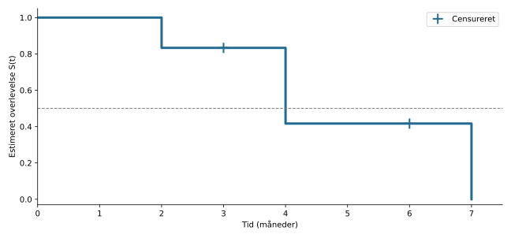

## Hvad skal vi kunne?

- Forklare tid til event, risikosæt og censurering.
- Læse en Kaplan–Meier-kurve og en log-rank-test.
- Fortolke koefficienter og hazard ratioer fra Cox-regression.
- Gennemskue immortal time bias og andre faldgruber.

Vi slutter med **opgave 2a og 2b fra SEMS, sommer 2026**.

## Outcome er en tid

Vi modellerer **tid indtil en hændelse**: død, tilbagefald, infektion eller udskrivelse.

To personer kan begge være i live ved sidste kontrol, men være fulgt i henholdsvis 1 og 10 år.

Et simpelt ja/nej-outcome mister den forskel.

Et gennemsnit af de observerede tider blander tid til event sammen med tid til sidste kontrol.

## Før analysen: definér tid nul og event

I eksamensopgaven følger vi patienter på venteliste til hjertetransplantation.

| Begreb | I opgave 2 |
|---|---|
| Tid nul | Inklusion på ventelisten |
| Event | Død |
| Observeret tid | `futime`: tid til død eller sidste opfølgning |
| Event-indikator | `fustat`: 1 = død, 0 = censureret |

Tid nul skal være klinisk relevant og sammenlignelig mellem patienter.

## Censureret betyder ikke event-fri for evigt

- A dør efter 3 måneder: Vi kender dødstidspunktet.
- B er i live efter 3 måneder og tabes derefter til opfølgning: Vi ved kun, at dødstidspunktet ligger **senere**.

B er **højrecensureret** efter 3 måneder.

B bidrager med information indtil da. Vi hverken fjerner B eller registrerer et dødsfald ved måned 3.

## Ikke-informativ censurering

Censurerede skal, givet de variable analysen tager højde for, være repræsentative for dem, der stadig følges, med hensyn til fremtidig eventtid.

- Studiets planlagte afslutning er ofte en rimelig censureringsgrund.
- Hvis de mest syge forsvinder fra opfølgningen, kan overlevelsen blive overvurderet.
- Også administrativ censurering kan give problemer, hvis prognosen ændres med kalenderperioden for inklusion.

**Årsagen til censurering skal vurderes.**

## Tre centrale begreber

$$S(t)=P(T>t)$$

**Overlevelsesfunktionen:** Sandsynligheden for at være event-fri efter tid $t$.

**Risikosættet:** De personer, som stadig observeres og endnu ikke har haft event lige før $t$.

**Hazard $h(t)$:** Den øjeblikkelige event-rate blandt dem, der endnu er event-frie. En rate har enhed fx pr. måned og er ikke en sandsynlighed.

## Et lille datasæt

| Patient | Tid (måneder) | Event |
|---|---:|---:|
| A | 2 | 1 |
| B | 3 | 0 |
| C | 4 | 1 |
| D | 4 | 1 |
| E | 6 | 0 |
| F | 7 | 1 |

**Spørgsmål:** Hvem er i risiko lige før måned 4?

::: {.fragment}
C, D, E og F. A er død, og B er censureret.
:::

## Kaplan–Meier: ét trin ad gangen

$$\widehat S(t)=\prod_{t_i\leq t}\left(1-\frac{d_i}{n_i}\right)$$

$n_i$: antal i risiko lige før eventtidspunkt $t_i$.  
$d_i$: antal events ved $t_i$ (kan være flere end ét).

| Tid | I risiko | Events | Betinget overlevelse | $\widehat S(t)$ |
|---|---:|---:|---:|---:|
| 2 | 6 | 1 | $5/6$ | $0.833$ |
| 4 | 4 | 2 | $2/4$ | $0.417$ |
| 7 | 1 | 1 | $0/1$ | $0$ |

Censurering ved 3 og 6 reducerer senere risikosæt, men giver **ikke** et fald i kurven.

## Sådan ser kurven ud

{height=410 fig-alt="Overlevelsen falder fra 1 til 5/6 ved måned 2, til 5/12 ved måned 4 og til 0 ved måned 7. Censurering ved måned 3 og 6 giver ingen fald."}

Den sidste del bygger på meget få personer. Et stort trin er ikke nødvendigvis stærk evidens.

## Prøv Kaplan–Meier i R

::: {.smaller}
Kør cellen. Data er et **konstrueret undervisningseksempel**, ikke eksamensdata.

```{webr-r}
library(survival)
lille <- data.frame(
  tid = c(2, 3, 4, 4, 6, 7),
  event = c(1, 0, 1, 1, 0, 1)
)
km <- survfit(Surv(tid, event == 1) ~ 1, data = lille)
summary(km)
plot(km, xlab = "Måneder", ylab = "S(t)",
     mark.time = TRUE, conf.int = FALSE)
```
:::

## Hvad betyder R-koden?

```r
survfit(Surv(tid, event == 1) ~ 1, data = lille)
```

- `Surv()` samler tid og event-indikator i et overlevelsesobjekt.
- `event == 1` angiver eksplicit, hvad der tæller som event.
- `~ 1` giver én samlet kurve.
- `~ factor(gruppe)` ville give en kurve pr. gruppe.

**Kontrollér altid kodningen:** I andre datasæt kan fx 1 betyde censureret og 2 betyde død.

## Læs en overlevelseskurve

- Højden ved $t$ estimerer sandsynligheden for at være event-fri efter $t$.
- Et fald viser events. Et censureringsmærke viser afsluttet observation uden event.
- Konfidensbånd viser usikkerhed, som typisk vokser sent i forløbet.
- En tabel med **antal i risiko** viser, hvor mange kurven bygger på.

Kurven estimerer ikke, hvornår en bestemt patient vil dø.

## Median overlevelse

Medianen er det første tidspunkt, hvor $\widehat S(t)\leq 0.5$.

I vores lille eksempel er medianen **4 måneder**.

Hvis kurven aldrig når 0.5, er medianen ikke nået og kan ikke estimeres ud fra den observerede kurve.

To grupper kan have samme median og alligevel have forskellige overlevelsesforløb. Se på hele kurven.

## Fra kurver til en test

**Kaplan–Meier:** Hvordan ser overlevelsen ud?

**Log-rank:** Er der evidens imod ens overlevelsesfunktioner i grupperne?

**Cox-regression:** Hvordan hænger forklarende variable sammen med hazard, eventuelt efter justering?

En figur, en p-værdi og et effektmål besvarer forskellige spørgsmål.

## Log-rank-testen

$$H_0:S_0(t)=S_1(t)\text{ for alle }t$$

Ved hvert eventtidspunkt sammenligner testen **observerede** events med de **forventede** under nulhypotesen, ud fra gruppernes risikosæt.

Afvigelserne samles over opfølgningen.

`survdiff(..., rho = 0)` er den almindelige log-rank-test; `rho = 0` er standard.

For to grupper sammenlignes teststørrelsen med en $\chi^2$-fordeling med 1 frihedsgrad.

## Eksamen 2a: tidligere kirurgi

::: {.smaller}
`surgery` angiver bypassoperation **før** inklusion på ventelisten.

```r
survdiff(Surv(futime, fustat == 1) ~ factor(surgery),
         data = d_sems)
```

Udskrift fra eksamenssættet:

```text
                   N Observed Expected (O-E)^2/E (O-E)^2/V
factor(surgery)=0  87       66     58.6     0.938      4.44
factor(surgery)=1  16        9     16.4     3.348      4.44

Chisq= 4.4 on 1 degrees of freedom, p= 0.04
```

Hvilken analyse er det, og hvad kan vi konkludere?
:::

## Eksamen 2a: læs tabellen

| Kolonne | Betydning |
|---|---|
| `N` | Antal patienter i gruppen |
| `Observed` | Observerede dødsfald |
| `Expected` | Forventede dødsfald under $H_0$, ud fra risikosættene |

Uden tidligere kirurgi: **66 mod 58.6** forventede dødsfald.

Med tidligere kirurgi: **9 mod 16.4** forventede dødsfald.

Det peger mod bedre overlevelse i gruppen med tidligere kirurgi. De to bidrag i sidste kolonne skal **ikke** lægges sammen til teststørrelsen.

## Eksamen 2a: et muligt svar

Der er tale om en **log-rank-test** af nulhypotesen om ens overlevelsesfunktioner blandt patienter med og uden tidligere kirurgi.

Med $p=0.04$ forkastes nulhypotesen på 5 %-niveau. Der er evidens for forskel i overlevelse.

Gruppen med tidligere kirurgi har færre dødsfald end forventet under nulhypotesen, hvilket peger mod bedre overlevelse i denne gruppe.

Testen giver hverken en hazard ratio eller dokumentation for en kausal virkning af kirurgi.

## Log-rank: hvad skal vi passe på?

- Testen tager højde for censurering, men forudsætter passende, ikke-informativ censurering.
- Den estimerer ikke effektens størrelse og justerer ikke i sig selv for andre prognostiske variable.
- Den har god styrke ved proportionale hazards.
- Ved krydsende kurver kan tidlige og sene forskelle udligne hinanden.

Proportionale hazards er ikke et krav for at definere nulhypotesen om ens kurver. Problemet ved krydsende kurver er især styrke og fortolkning.

## Hazard ratio er et rateforhold

$$HR=\frac{h_1(t)}{h_0(t)}$$

- $HR=1$: Samme hazard.
- $HR=0.70$: 30 % lavere hazard i gruppe 1 end i referencegruppen.
- $HR=1.50$: 50 % højere hazard.

Under proportional hazards-antagelsen er forholdet konstant over tid.

**HR = 0.70 betyder ikke 30 % lavere sandsynlighed for død inden et bestemt tidspunkt eller 30 % længere levetid.**

## Cox proportional hazards-modellen

$$h(t\mid X)=h_0(t)\exp(\beta_1X_1+\cdots+\beta_pX_p)$$

- $h_0(t)$ er baseline hazard; vi behøver ikke specificere dens form.
- $\beta_j$ er en log-hazard ratio.
- $\exp(\beta_j)$ er HR for én enheds stigning i $X_j$, når øvrige variable holdes konstante.

Modellen håndterer censurering og flere forklarende variable samtidigt.

## Referencegruppe og enheder

For en indikator $X=0/1$:

$$\frac{h(t\mid X=1)}{h(t\mid X=0)}=e^\beta$$

Ved ombytning af referencen bliver HR til $1/HR$.

For alder målt i år er $e^{\beta_{alder}}$ HR pr. år og $e^{10\beta_{alder}}$ HR for 10 års forskel.

En justeret sammenhæng er ikke automatisk en kausal effekt.

## Prøv en justeret Cox-model i R {.smaller}

Et separat eksempel med `survival`-pakkens lungekræftdata. Her er **2 = død** og **1 = censureret**; dette er ikke eksamensdata.

```{webr-r}
library(survival)
d <- survival::lung
d$koen <- factor(d$sex, levels = c(1, 2),
                 labels = c("Mand", "Kvinde"))
fit <- coxph(Surv(time, status == 2) ~ koen + age,
             data = d)
summary(fit)
exp(confint(fit))
```

Læs HR for kvinde sammenlignet med mand **ved samme alder**. HR for `age` er pr. ekstra år. Dette er observerede sammenhænge.

## Sådan læses en Cox-udskrift

| Felt | Betydning |
|---|---|
| `coef` | Estimeret $\beta$: log-HR |
| `exp(coef)` | Estimeret HR |
| `se(coef)` | Standardfejl for log-HR |
| `z` | $\widehat\beta/SE(\widehat\beta)$ |
| `Pr(>|z|)` | Tosidet Wald-test af $\beta=0$, dvs. HR = 1 |

Et 95 % Wald-konfidensinterval for HR er:

$$\exp\left(\widehat\beta\pm 1.96\,SE(\widehat\beta)\right)$$

## Eksamen 2b: transplantation

::: {.smaller}
```r
summary(coxph(Surv(futime, fustat == 1) ~ factor(transplant),
              data = d_sems))
```

```text
n= 103, number of events= 75

                      coef exp(coef) se(coef)      z Pr(>|z|)
factor(transplant)1 -1.3234    0.2662   0.2438 -5.428 5.69e-08
```

`transplant` angiver, om patienten fik en transplantation **under opfølgningen**.

1. Hvilken model er det?
2. Hvordan læses tallet 0.2662?
3. Er denne analyse korrekt tilrettelagt?
:::

## Eksamen 2b: den umiddelbare fortolkning

$$HR=e^{-1.3234}\approx 0.266$$

Patienter klassificeret som transplanterede har i denne model cirka **73 % lavere hazard for død** end patienter klassificeret som ikke-transplanterede.

$$95\%\text{-KI}=\exp(-1.3234\pm1.96\cdot0.2438)
\approx(0.165;\,0.429)$$

P-værdien er meget lille. **Men en lille p-værdi retter ikke en forkert analyse.**

## Beregn HR og konfidensinterval

Kør cellen og prøv derefter at ændre `beta` til 0.

```{webr-r}
beta <- -1.3234
se <- 0.2438
c(HR = exp(beta),
  nedre = exp(beta - 1.96 * se),
  oevre = exp(beta + 1.96 * se))
z <- beta / se
2 * pnorm(-abs(z))
```

Hvad er nulværdien for henholdsvis koefficienten og HR?

::: {.fragment}
$\beta=0$ svarer til $HR=1$.
:::

## Fejlen: vi bruger viden fra fremtiden

Patienten skal **overleve frem til transplantationen** for at kunne blive klassificeret som transplanteret.

Hvis hele forløbet fra ventelisteinklusion tælles som transplanteret, tilskriver vi gruppen tid, hvor patienten endnu ikke var transplanteret, men nødvendigvis overlevede.

Det kaldes **immortal time bias**.

Tidlige dødsfald kan kun havne i gruppen uden transplantation. Sammenligningen giver dermed den transplanterede gruppe en kunstig fordel.

## En patient med transplantation på dag 30

| Periode | Faktisk status | Den naive analyse bruger |
|---|---|---|
| Dag 0–30 | Ikke transplanteret | Transplanteret |
| Dag 30–100 | Transplanteret | Transplanteret |

Patienten dør på dag 100.

De første 30 dage er fejlagtigt tilskrevet transplantation. En anden patient, som dør på dag 10, kan aldrig nå at komme i transplantationsgruppen.

**Immortal** beskriver klassifikationen af tiden; patienten er selvfølgelig ikke biologisk udødelig.

## Eksamen 2b: et muligt kritisk svar

Det er en Cox-regression. Den estimerede HR er 0.266, umiddelbart svarende til cirka 73 % lavere dødsrate blandt transplanterede.

Analysen er imidlertid fejlbehæftet, fordi transplantation sker under opfølgningen og behandles som en fast baseline-variabel.

Patienterne skal overleve frem til transplantation for at blive klassificeret som transplanterede. Denne immortal time bias giver transplantation en kunstig overlevelsesfordel og trækker HR nedad.

Resultatet kan derfor ikke bruges som et pålideligt estimat for transplantationens effekt.

## Hvordan tænkes tiden korrekt?

Transplantationsstatus skal være **tidsafhængig**: 0 før transplantation, 1 efter.

Et illustrativt forløb kan opdeles sådan:

| id | start | stop | død ved stop | transplanteret |
|---|---:|---:|---:|---:|
| 1 | 0 | 30 | 0 | 0 |
| 1 | 30 | 100 | 1 | 1 |

```r
coxph(Surv(start, stop, event) ~ transplant, data = intervaller)
```

::: {.smaller}
Princippet ligger ud over den nødvendige beregning i opgave 2b. Korrekt tidskodning fjerner denne fejlkilde, men sikrer ikke i sig selv kontrol for confounding.
:::

## Tidligere kirurgi eller senere transplantation?

| | `surgery` | `transplant` |
|---|---|---|
| Tidspunkt | Før inklusion | Under opfølgningen |
| Kendt ved tid nul? | Ja | Fremtidig transplantation: nej |
| Fast gruppe fra tid nul? | Rimelig tidskodning | Skaber immortal time bias |

**Spørg altid:** Kunne vi have bestemt gruppen på det tidspunkt, hvor opfølgningen begyndte?

## Proportionale hazards

Cox-modellen med faste koefficienter antager et konstant hazardforhold over tid.

Det betyder **ikke**, at hazard er konstant, eller at overlevelseskurverne har konstant afstand.

Krydsende kurver, forsinket separation eller en biologisk forventning om ændret effekt giver anledning til nærmere vurdering.

Til diagnostik findes `cox.zph(fit)` og tilhørende plots. En ikke-signifikant test er ikke bevis for, at antagelsen holder.

## Én HR kan skjule tidsforløbet

Hvis hazardforholdet ændres over tid, kan én samlet HR være en misvisende opsummering og afhænge af opfølgningslængden.

Selv i et randomiseret studie sammenligner hazard ved et senere tidspunkt de personer, der **stadig er event-frie** i hver gruppe.

Disse grupper kan over tid have forskellig sammensætning, fordi event og overlevelse har selekteret dem forskelligt.

Se også på overlevelseskurver og absolutte forskelle ved relevante tidspunkter.

## Competing risks

Ved **tid til recidiv** kan patienten dø uden først at få recidiv. Død forhindrer da det event, vi undersøger.

Ved **tid til melanomdød** er død af andre årsager en konkurrerende hændelse.

Man kan ikke uden videre censurere konkurrerende hændelser og fortolke $1-\widehat S(t)$ som sandsynligheden for det bestemte event i virkeligheden.

Det kræver andre metoder, som ligger uden for dette kursus. Ved tid til død af alle årsager er andre dødsårsager en del af eventet.

## Øvelse: vælg metode og fortolkning

1. Vi ønsker sandsynligheden for at være i live efter 1 år. Hvilken metode?
2. To grupper har $p=0.30$ i en log-rank-test. Har vi vist ens overlevelse?
3. En Cox-model giver $\beta=\log(1.5)$ for alder pr. 10 år. Hvad betyder det?
4. Vi grupperer patienter efter, om de gennemfører 6 måneders behandling. Hvilken fejl kan opstå?

## Øvelse: svar

1. Kaplan–Meier: aflæs eller beregn $\widehat S(1\text{ år})$, og angiv usikkerhed.
2. Nej. Vi har ikke tilstrækkelig evidens til at forkaste ens kurver; det dokumenterer ikke lighed.
3. 50 % højere hazard ved 10 års højere alder, med øvrige variable holdt konstante og under modellens antagelser.
4. Immortal time bias, hvis hele opfølgningen fra start tilskrives en gruppe bestemt af senere gennemførelse.

## Tjekliste til eksamenssvaret

1. **Data:** Hvad er tid nul, event og censurering?
2. **Metode:** Kaplan–Meier, log-rank eller Cox?
3. **Hypotese:** Ens kurver eller HR = 1?
4. **Tal:** Reference, retning, størrelse og usikkerhed.
5. **Kritik:** Censurering, PH, confounding og tidsafhængig eksponering.

I opgave 2b er den afgørende pointe **immortal time bias**, ikke blot at p-værdien er lille.

## Materiale og R-dokumentation {.smaller}

Fagligt niveau og emner følger Torben Martinussens SEMS-forelæsninger:

- F11: Overlevelsesanalyse I. Hvad, pitfalls.
- F12: Overlevelsesanalyse II. Kaplan-Meier og Log-rank test.
- F13: Overlevelsesanalyse III. Cox-regression.

Eksamenseksempler og viste udskrifter: **SEMS, ordinær eksamen 22. maj 2026, Statistik, opgave 2a–b**, inklusive modelbesvarelse. Patientdata fra opgaven er ikke vedlagt; udskrifterne er gengivet, ikke genberegnet. Det lille seks-patienters datasæt er konstrueret.

[R-pakken survival: funktionsoversigt](https://stat.ethz.ch/R-manual/R-devel/library/survival/html/00Index.html) · [Surv](https://stat.ethz.ch/R-manual/R-devel/library/survival/html/Surv.html) · [survdiff](https://stat.ethz.ch/R-manual/R-devel/library/survival/html/survdiff.html) · [coxph](https://stat.ethz.ch/R-manual/R-devel/library/survival/html/coxph.html)
